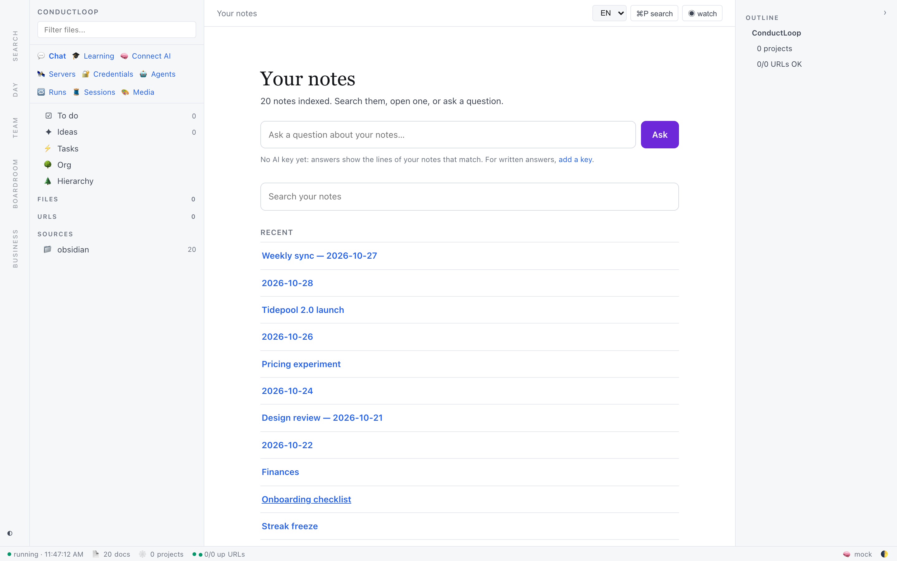
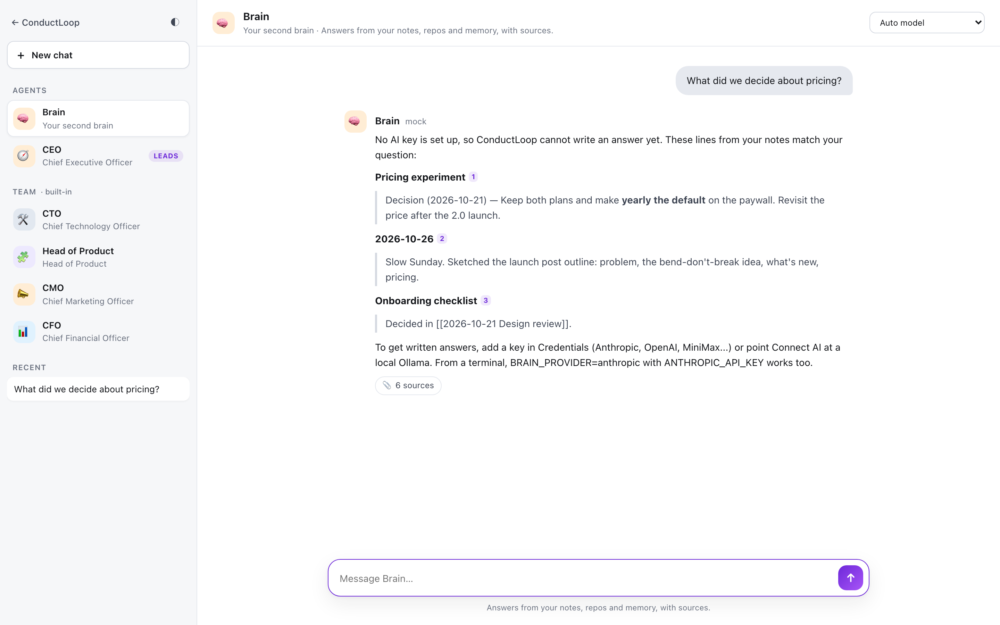
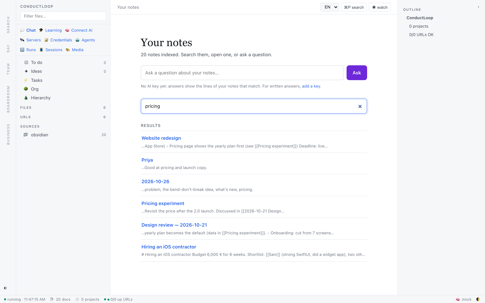

# ConductLoop

> Your notes, searchable and askable, on your own computer. Free and open source (MIT).



ConductLoop reads your notes (an Obsidian vault or any folder of Markdown) and lets you search them and ask questions about them. Answers come from your notes, with their sources. Everything stays on your computer: the index is a local SQLite file, and the AI is the model you choose, with your own key (Anthropic, OpenAI, MiniMax, any OpenAI-compatible server, or a local Ollama). Without a key it still searches, and answers with the lines of your notes that match.

It never writes into your notes folder: its own notes (daily briefing, agent notes) go to a folder of their own.

## Download

| System | Download | Notes |
|---|---|---|
| macOS 13 or later, Apple Silicon | [ConductLoop.dmg](https://github.com/EVMCOD/conductloop-releases/releases/latest/download/ConductLoop-macos-aarch64.dmg) | Signed and notarized. Updates itself (ConductLoop → Check for Updates…). The in-app browser needs macOS 14 or later. |
| **Linux** x86_64 · beta | [AppImage](https://github.com/EVMCOD/conductloop-releases/releases/download/v1.2.3-linux-experimental.1/ConductLoop_1.2.3_amd64.AppImage) · [.deb](https://github.com/EVMCOD/conductloop-releases/releases/download/v1.2.3-linux-experimental.1/ConductLoop_1.2.3_amd64.deb) | Tested on Ubuntu 22.04 and 24.04. No in-app browser; no automatic updates yet. |
| **Windows** 10/11 x64 · beta | [setup.exe](https://github.com/EVMCOD/conductloop-releases/releases/download/v1.2.3-windows-experimental.1/ConductLoop_1.2.3_x64-setup.exe) | Not code-signed, so SmartScreen says "Windows protected your PC": click **More info**, then **Run anyway**. No in-app browser; no automatic updates yet. |

All releases, with checksums: [conductloop-releases](https://github.com/EVMCOD/conductloop-releases/releases).

## The first minute

1. **Open it.** The welcome page asks for the folder with your notes ("Choose…") and indexes it.
2. **Ask or search** from the home page. Each result opens the note.
3. **Optional:** paste an AI key in Credentials for written answers. It is stored in the system keychain (the Keychain on a Mac) or in an encrypted file, and never shown again.

| Ask your notes | Search them |
|---|---|
|  |  |

## And beyond your notes

- **A team of AI agents.** Ask the CEO agent and it splits the work across a CTO, Head of Product, CMO and CFO, and writes one answer. Or create your own agents with tools and a schedule.
- **Connectors** for GitHub, Slack, Gmail and more, read-only unless you allow writes; every write waits for your confirmation. They keep their tokens in the system keychain only, so they need macOS or Linux with a keyring.
- **MCP both ways.** Plug MCP servers in as tools for your agents (read-only by default; anything that writes waits for you). From a source install, `ops mcp` lets Claude or another agent search and ask your notes.
- **Backups** of the local database, daily and before every upgrade, restorable from Setup.
- **It learns from your 👍/👎**: proposed rules that you approve, all stored on your computer.

The screenshots use a fictional vault. Dark theme: ◐ in the corner.

---

## For developers

> The Python package is still named `ops_dashboard` for backwards compatibility. The product name is **ConductLoop**.

### Principles

#### Local-first
- The server is a stdlib `http.server` that binds to `127.0.0.1:7777` by default.
- All indexed content, memory, tasks and settings live in a local SQLite file (`ops.db`). Location, in order of precedence:
  1. `$OPS_DATA_DIR/ops.db`
  2. `<repo>/data/ops.db` (dev checkout, if `data/` exists)
  3. macOS `~/Library/Application Support/com.conductloop.desktop/data/ops.db` · Linux `~/.local/share/conductloop/ops.db` · Windows `%LOCALAPPDATA%\ConductLoop\data\ops.db`
- At-rest secrets (DB encryption key, connector credentials) go to the macOS Keychain, or to `0600` files in the data dir elsewhere (`ops_dashboard/secrets_store.py`). Connector credentials are Fernet-encrypted in the DB.
- Network calls only happen for features you turn on: your model provider, connectors you configure (GitHub, Slack, Telegram, Discord, Google Search Console/Analytics, Sentry, …), URL health checks, webhooks, and the Tauri auto-updater in the desktop app.
- Error reporting to Sentry is **opt-in** (only if you set `SENTRY_DSN`).
- If you install `sentence-transformers`, the embedding model (`all-MiniLM-L6-v2`) is downloaded once from Hugging Face and then runs locally.

#### BYOK (bring your own key)
The Brain talks directly to the provider you configure; nothing is proxied through ConductLoop servers.

| Provider (`BRAIN_PROVIDER`) | Needs |
|---|---|
| `anthropic` | `ANTHROPIC_API_KEY` |
| `openai` | `OPENAI_API_KEY` |
| `minimax` | `MINIMAX_API_KEY` (OpenAI-compatible; `MINIMAX_BASE_URL` optional) |
| `gateway` | `GATEWAY_API_KEY` for an OpenAI-compatible gateway (`GATEWAY_BASE_URL`, default Vercel AI Gateway) |
| `ollama` | a local Ollama on `localhost:11434` (`OLLAMA_MODEL`, `OLLAMA_BASE_URL` optional) |
| `mock` | nothing — offline/testing |

`BRAIN_PROVIDER=auto` (default) picks the first available provider; `BRAIN_MODEL` overrides the model. Keys can also be set from the UI (`/credentials`), which stores them in the macOS keychain or, where there is none, in an encrypted file protected by a passphrase — never in plain text. Other settings live in your local `config.json` (`$OPS_CONFIG_PATH`, or in the data directory); it is gitignored — never commit it.

---

### Install

#### From source (macOS / Linux)
Requires Python **3.13+** (CI runs 3.14).

```bash
git clone https://github.com/EVMCOD/conductloop.git
cd conductloop
python3 -m venv .venv && .venv/bin/pip install -r requirements.txt
make serve            # → http://127.0.0.1:7777
```

Then, optionally, point it at your content and index it:

```bash
cp .env.example .env  # the make targets load .env automatically
make index            # index all configured sources
```

Dependency sets:
- `requirements-core.txt` — lean runtime (server, CLI, auth, search). No ML.
- `requirements.txt` — core + Anthropic/OpenAI SDKs + local semantic search: `fastembed` (ONNX, no PyTorch; what the app uses) and `sentence-transformers` (pulls PyTorch, ~2 GB).
- `requirements-optional.txt` — Whisper voice notes, Google Analytics, PyJWT, Sentry, MCP server.
- `requirements-dev.txt` — core + pytest, ruff, mypy, pip-audit, pre-commit.

`pip install -e .` also installs the `ops` CLI entry point.

#### Configuration
A fresh install is empty: no projects, teams or URLs. Point it at your content with environment variables (see `.env.example`), e.g. `OPS_VAULT_ROOT`, `OPS_WORKSPACE`, `OPS_SKILLS_DIR`, `OPS_REPOS`, `OPS_PROJECTS_FILE`, `OPS_LIVE_URLS_FILE`. Set `CONDUCTLOOP_DEMO=1` (with a throwaway `CONDUCTLOOP_DB_PATH` and `OPS_DATA_DIR`) to load fictional demo data instead; see [`docs/FIRST-5-MINUTES.md`](docs/FIRST-5-MINUTES.md).

Optional notification webhooks (Slack / Discord / Telegram) are described in `config.example.json`. Remote access from a phone is documented in [`docs/REMOTE.md`](docs/REMOTE.md) (Tailscale; nothing is exposed publicly by default).

---

### Usage

```bash
make help        # list targets
make index       # reindex everything
make serve       # start the web UI on :7777
make brain       # ask the Brain from the terminal
make briefing    # morning briefing
make snapshot    # take a daily snapshot
make diff        # diff today vs yesterday
```

Selected `ops` / `python -m ops_dashboard` commands: `index`, `find`, `brain`, `briefing`, `capture`, `todos`, `projects`, `playbook`, `snapshot`, `backup`, `export` / `import`, `sync-export` / `sync-import` (passphrase-encrypted bundle), `obsidian-sync`, `calendar-import`, `mcp` (expose the Brain over MCP), `setup` (readiness checklist). Run `ops --help` for the full list.

---

### Development

```bash
python3 -m venv .venv && . .venv/bin/activate
pip install -r requirements-dev.txt
pre-commit install                  # optional: ruff + basic hygiene hooks

ruff check ops_dashboard tests      # lint (blocking in CI)
mypy ops_dashboard                  # type check (advisory in CI; a strict subset is blocking)
pytest -m "not live"                # hermetic test suite (what CI runs)
```

Tests marked `live` need the network or real credentials; they never run by default or in CI.

#### Layout
```
ops_dashboard/          Python package: server.py (HTTP API + UI), cli.py (typer CLI),
                        db*.py (SQLite schema/queries), brain.py (RAG + providers),
                        indexers/ (vault, memory, repos, skills, urls, …), web/ (vanilla HTML/JS UI)
desktop/                Tauri v2 macOS app (Rust shell + PyInstaller sidecar build)
desktop-demo/           Tauri demo build
scripts/, bin/          launchd jobs, release and maintenance scripts
tests/                  pytest suite
```

#### Desktop app
See [`desktop/README.md`](desktop/README.md) and [`desktop/docs/DISTRIBUTION.md`](desktop/docs/DISTRIBUTION.md). Building and signing a release needs your own Apple Developer ID and your own Tauri updater key; neither is in this repository.

Linux (experimental) and Windows are **not shipped**. [`docs/PORTABILITY.md`](docs/PORTABILITY.md) is the audit of everything that is macOS-only today, with the plan to port it.

---

### Contributing & security
- [CONTRIBUTING.md](CONTRIBUTING.md)
- [SECURITY.md](SECURITY.md) — please report vulnerabilities privately, not in public issues.

### License
[MIT](LICENSE). The ConductLoop name and logo are not covered by the license.
